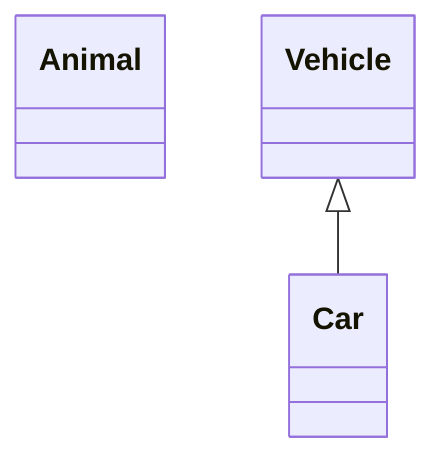
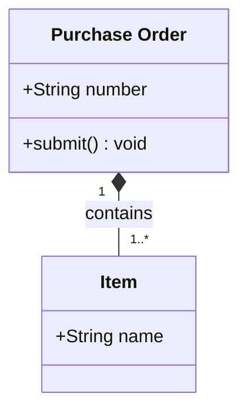
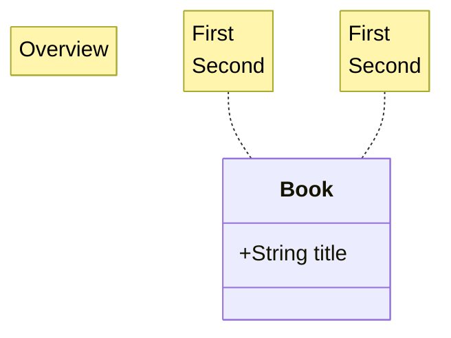

# Class diagrams

## Class declarations

Compare with [Mermaid: Define a class](https://mermaid.js.org/syntax/classDiagram.html#define-a-class).

## Composition and members

Edit the class alias, members, and relationship label. Drag Purchase Order twice, then Item. Check that the line, label, and multiplicities follow each move. Save and reopen, then reset styles; the text edits, class IDs, and composition operator should survive.

## Standalone and attached notes

For each note, edit its text, drag twice, and change fill and stroke without reselecting. Try the fill pattern, stroke width and pattern, roughness, opacity, corners, font, and alignment. Save and reopen. The two identical notes should keep independent formatting; reset should preserve text and class attachments.
