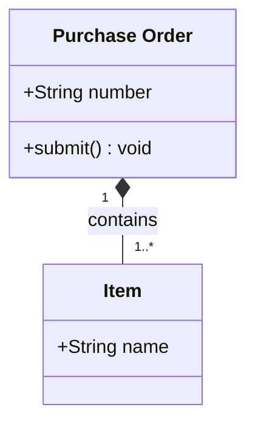

# Class mapping

Tests that a class alias, members, and a relationship label can be edited without changing class IDs, the UML relationship operator, or multiplicities. Drag Purchase Order twice, then drag Item. Check that the line, label, and multiplicities follow during each drag. Save and reopen to check both positions, then use **Reset styles** to restore the default layout without losing text edits.

Text after the diagram should remain unchanged.
