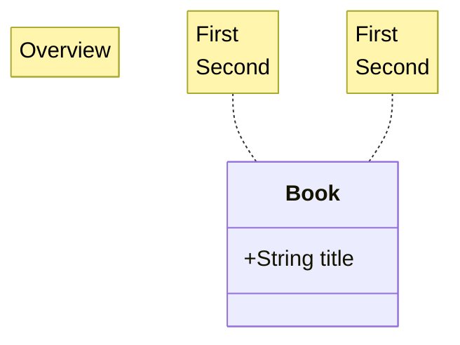

# Class note editing

Tests standalone and class-attached notes, including identical text and multiple notes on one class.
For each note: edit its text, drag twice, change fill and stroke consecutively without reselecting,
save and reopen, then reset formatting. Check that only that note changes, its class attachment
stays intact, and its connector follows either endpoint during a drag.
Also test fill pattern, stroke width/pattern, roughness, opacity, rounded corners, font family/size,
and horizontal/vertical text alignment. Repeat after reopening; reset must keep edited text.

Unrelated text must remain unchanged.
