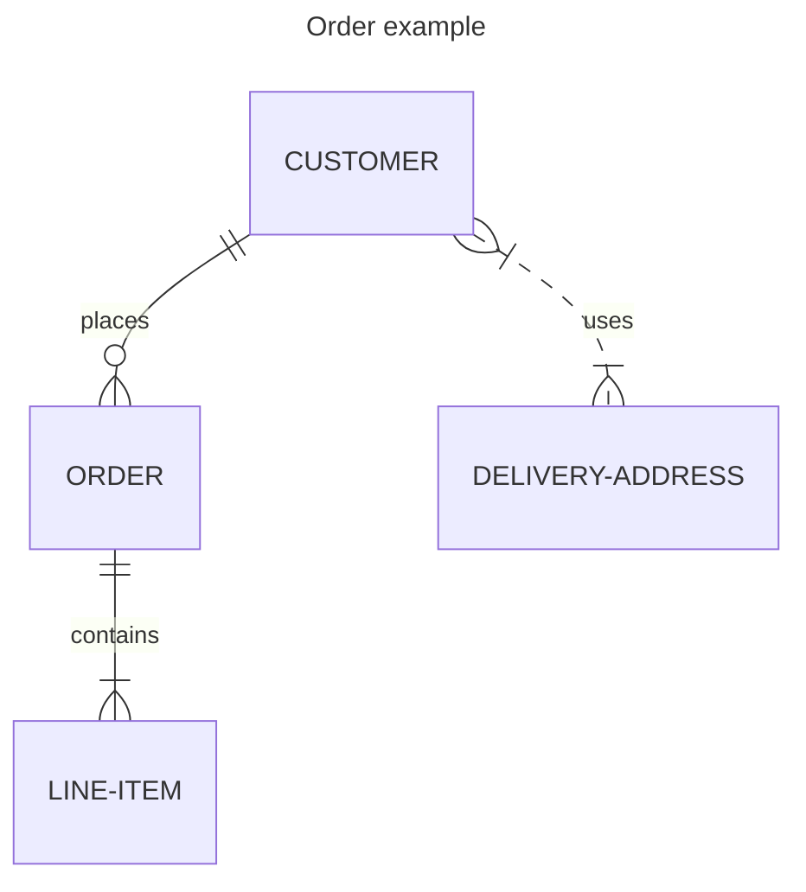

# Entity relationship diagrams

## Order relationships



Compare with **Order example** in [Mermaid: Entity Relationship Diagrams](https://mermaid.js.org/syntax/entityRelationshipDiagram.html#entity-relationship-diagrams).

## Attributes and subgraphs

```mermaid
erDiagram
    direction LR
    subgraph SALES [Sales]
        CUSTOMER["Customer account"] {
            int id PK
            string? email UK "Contact address"
        }
        subgraph ORDERS [Orders]
            ORDER {
                int id PK
                int customerId FK
            }
        end
        CUSTOMER ||--o{ ORDER : places
    end
    ORDER }o..|| CHANNEL : uses
```

Edit an attribute and a relationship label, then move an entity. Check that the alias, keys, comment, nested groups, and relationship cardinalities survive.
