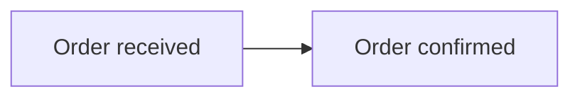
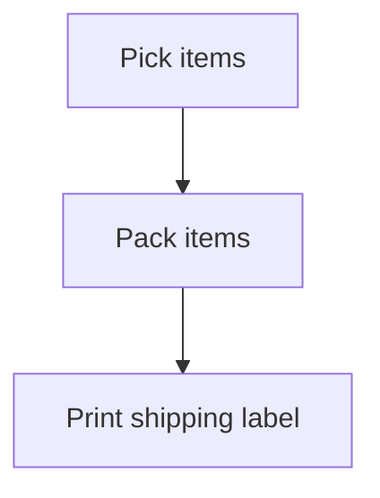
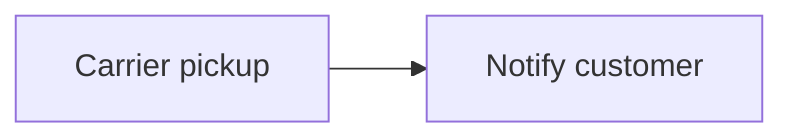

# Order workflow

This document describes how an order is received, prepared, and shipped.

## Receive the order



Once the order is confirmed, send it to the warehouse for packing.

## Prepare the package



Record the tracking number before handing the package to the carrier.

```text
Tracking status: awaiting pickup
```

## Ship the package



## Footer

End of the order workflow. Keep this footer unchanged when exporting the diagrams.
