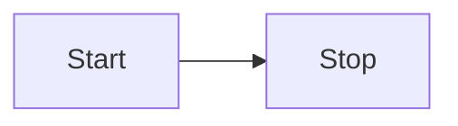
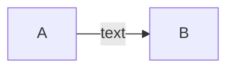
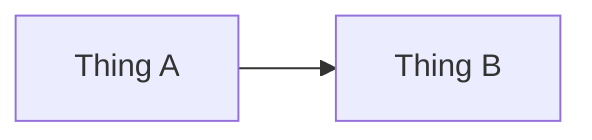
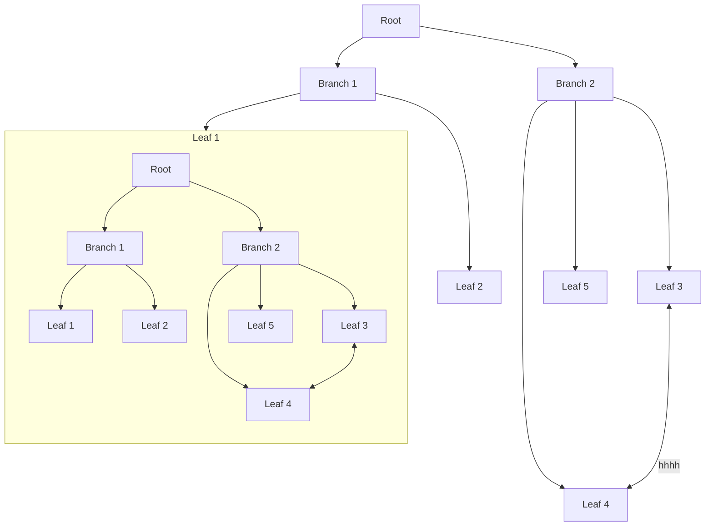
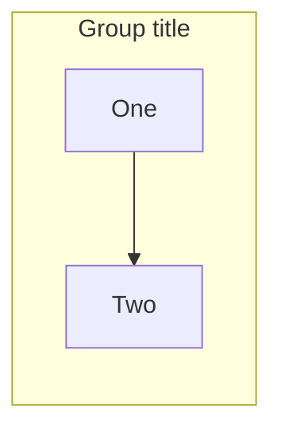
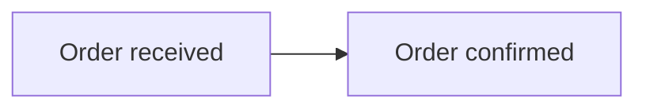
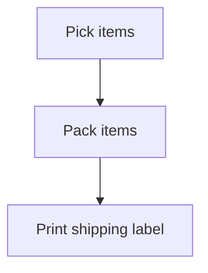
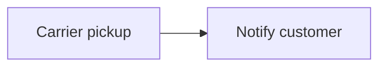

# Flowcharts

## Left-to-right direction



Compare with the left-to-right example in [Mermaid: Direction](https://mermaid.js.org/syntax/flowchart.html#direction).

## Labeled arrow



Compare with [Mermaid: A link with arrow head and text](https://mermaid.js.org/syntax/flowchart.html#a-link-with-arrow-head-and-text).

## Labeled nodes



Delete the arrow. Both labels should remain, including when opening the block as a standalone `.mermaid` file.

## Subgraph direction



Change the subgraph title's fill and opacity. Check that **Reset styles** clears both without changing its nodes or links.

## Implicit subgraph ID



## Saved node position


Change the fill, then reset. Both the saved position and the new fill should clear.

The next three diagrams intentionally reuse node IDs. Edit the first and last of the three; verify that the middle diagram, prose, text fence, and footer survive export unchanged.

## Receive the order



Once the order is confirmed, send it to the warehouse for packing.

## Prepare the package



Record the tracking number before handing the package to the carrier.

```text
Tracking status: awaiting pickup
```

## Ship the package



## Footer

End of the order workflow. Keep this footer unchanged when exporting the diagrams.
