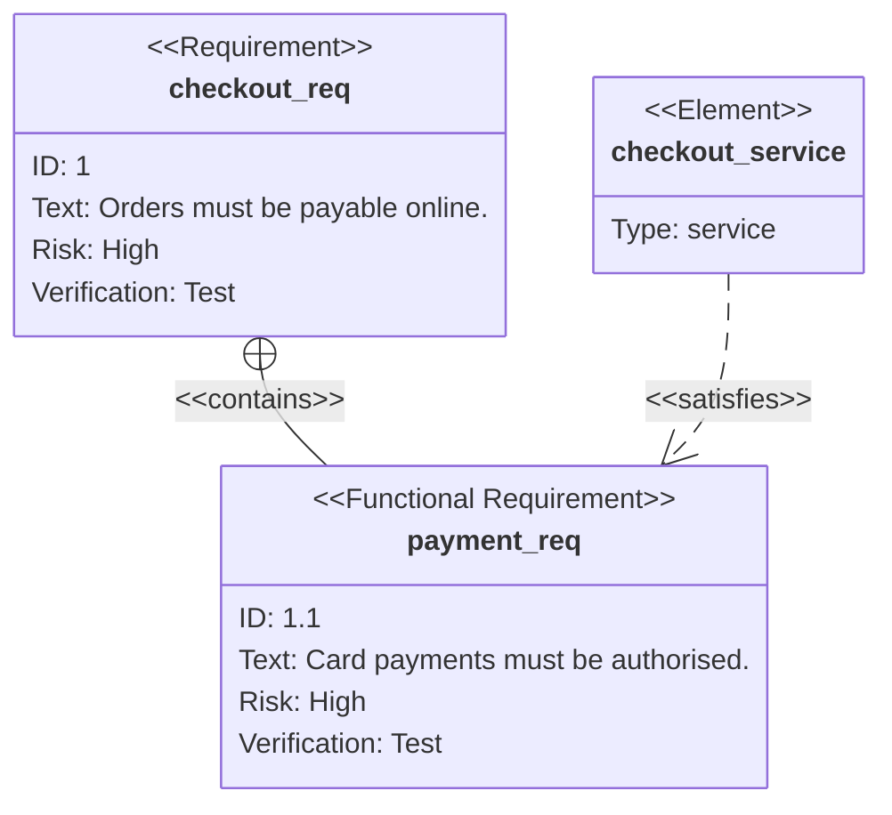
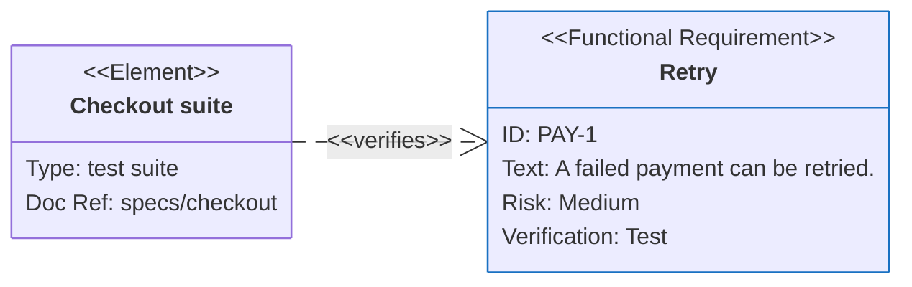
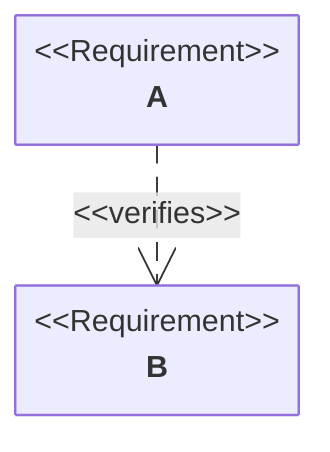

# Requirement diagrams

## Checkout relationships

Compare with [Mermaid: Requirement Diagram - With the defaults](https://mermaid.js.org/syntax/requirementDiagram.html#with-the-defaults).
Move the checkout service beside the checkout requirement. Their arrows to the payment requirement should stay distinct.

## Fields and reverse links

Edit Retry's risk and the relationship type. Save and reopen; the changes should keep the reverse arrow notation and leave the other diagrams untouched.

## Connector bends

Select the bend and switch between Sharp, Curved, and Elbow. After download and reopen, the route should keep its style and still connect A to B with `verifies`.
