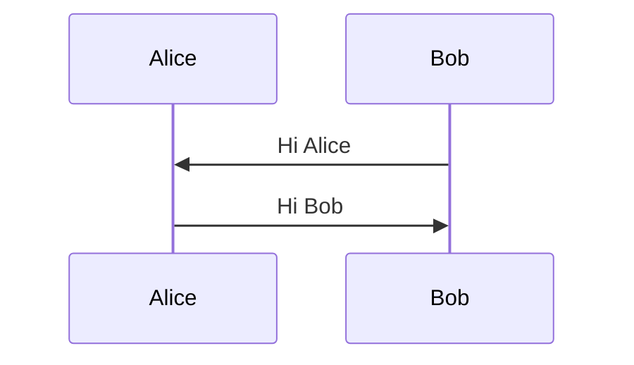
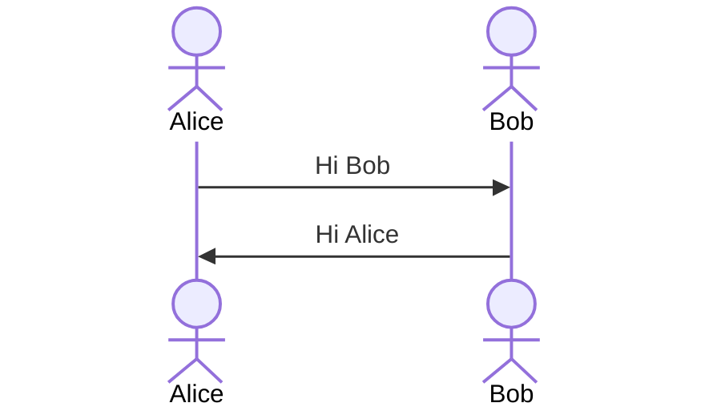
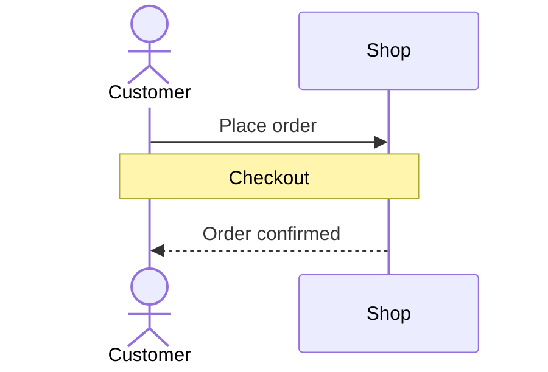

# Sequence diagrams

## Explicit participants

Compare the participant order with [Mermaid: Participants](https://mermaid.js.org/syntax/sequenceDiagram.html#participants).

## Actors

Compare with [Mermaid: Actors](https://mermaid.js.org/syntax/sequenceDiagram.html#actors).

## Message order and notes

Double-click a participant, message, or note to edit its text. Drag the reply above the request; check the source order, participant IDs, and dashed return arrow.
Move and color a participant, then save and reopen. **Reset styles** should clear colors and positions without undoing text edits or reordering.
