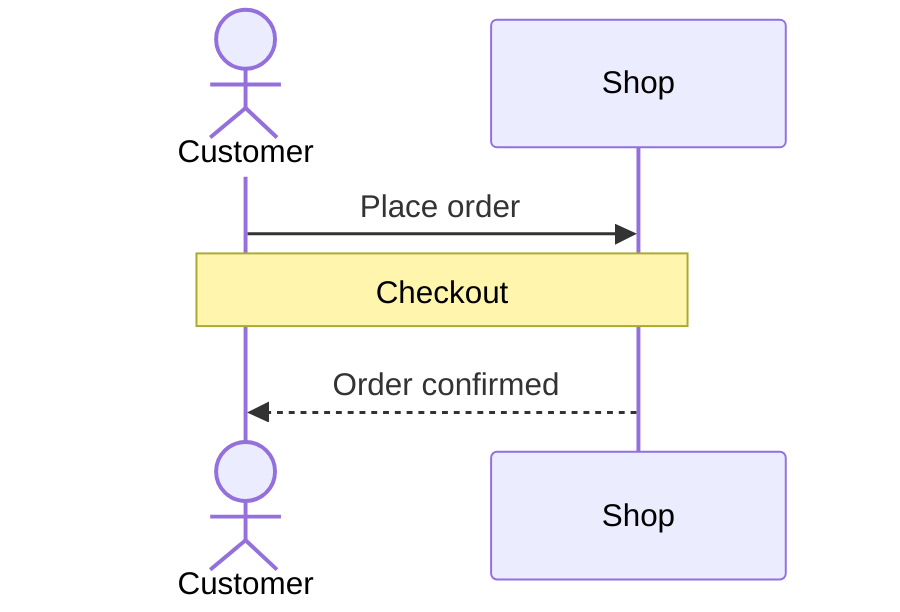

# Sequence mapping

Double-click a participant box, message arrow, or note to edit its text. Check that actor and participant IDs are unchanged. Drag a message past another, then save and reopen to check statement order and the dashed return arrow.

Drag a participant a short distance without crossing columns and change its fill. Save and reopen to check that both edits persist. Use **Reset styles** to clear colors and positions without undoing text edits or reordering.

Text after the diagram should remain unchanged.
