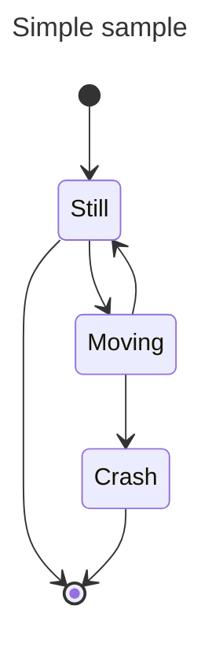
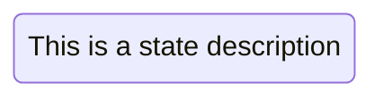
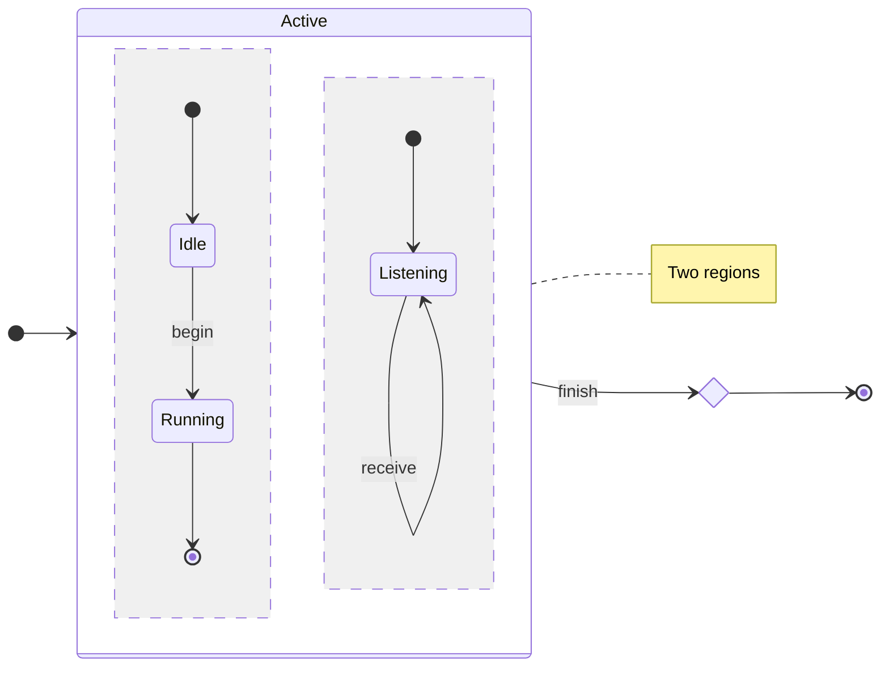

# State diagrams

## State transitions

Compare with **Simple sample** in [Mermaid: State diagrams](https://mermaid.js.org/syntax/stateDiagram.html#state-diagrams).

## State aliases

Compare with the `as` example in [Mermaid: States](https://mermaid.js.org/syntax/stateDiagram.html#states).

## Concurrent regions

Rename or move a state inside Active. Check that transitions stay connected, start/end markers remain in their own regions, and the note still belongs to Active.
