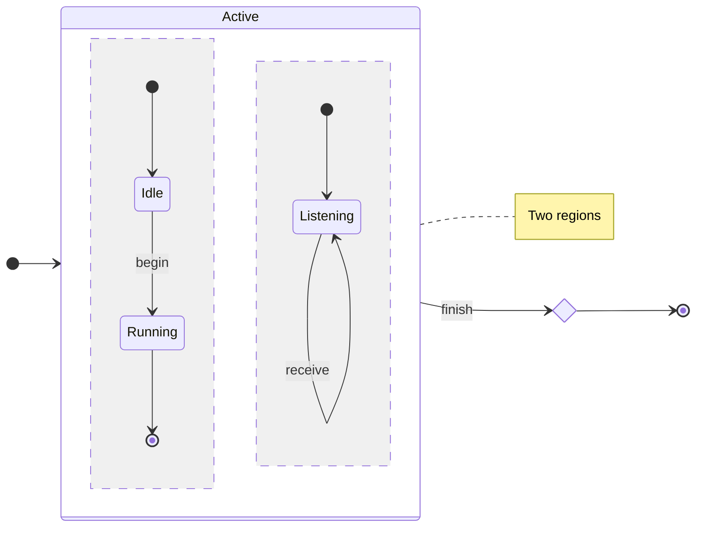

# State mapping

Tests scoped start and end markers, a composite state with concurrent regions, a choice, and a note. Rename a state or transition, move a state, and check that its transitions stay connected.

